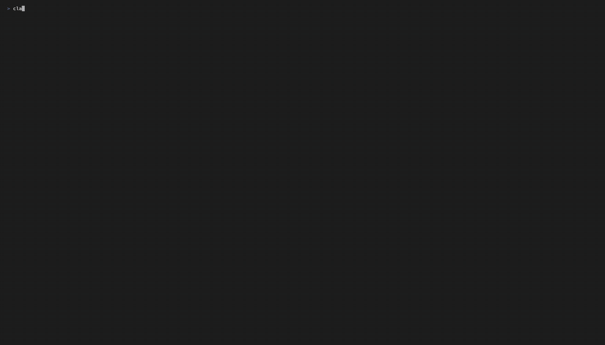
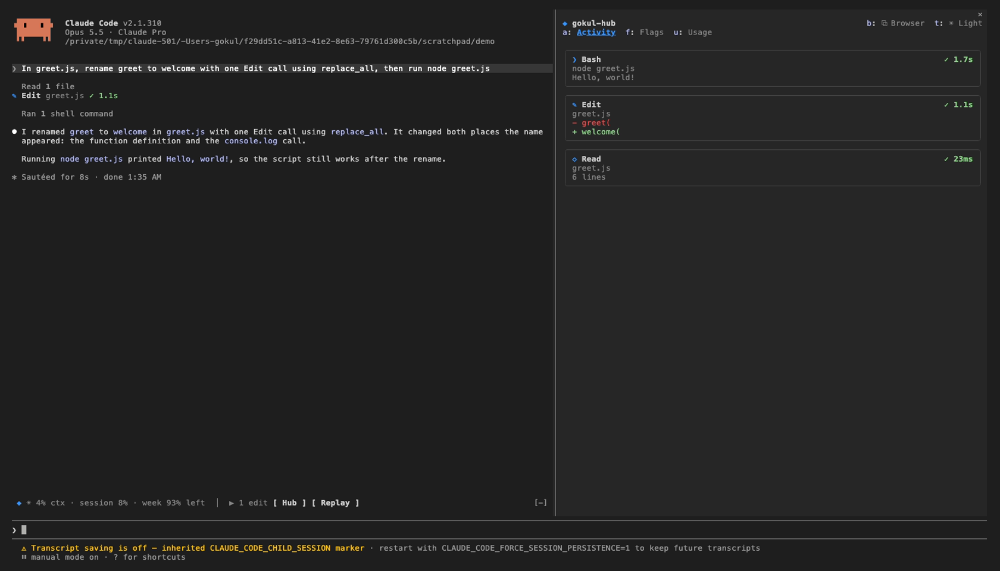
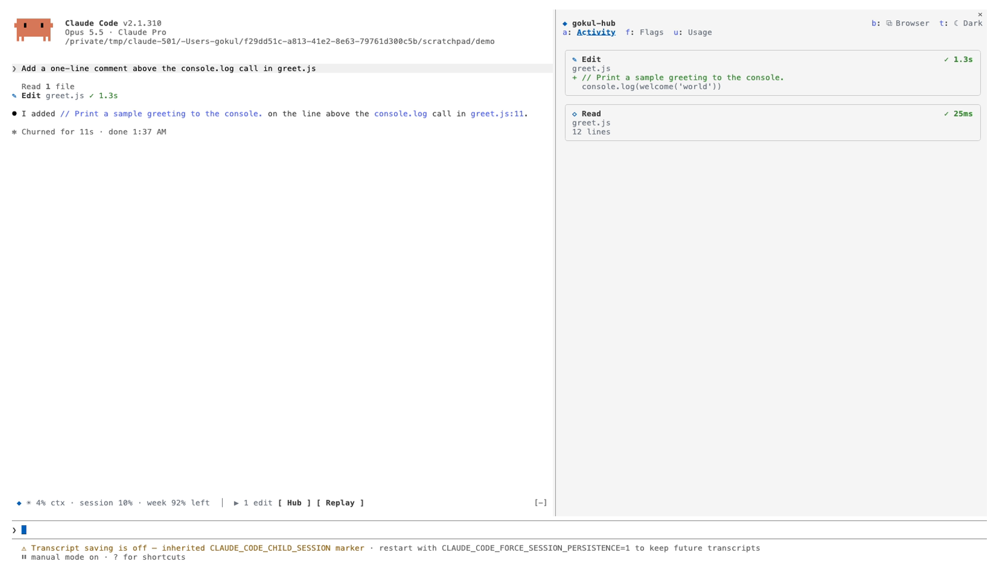
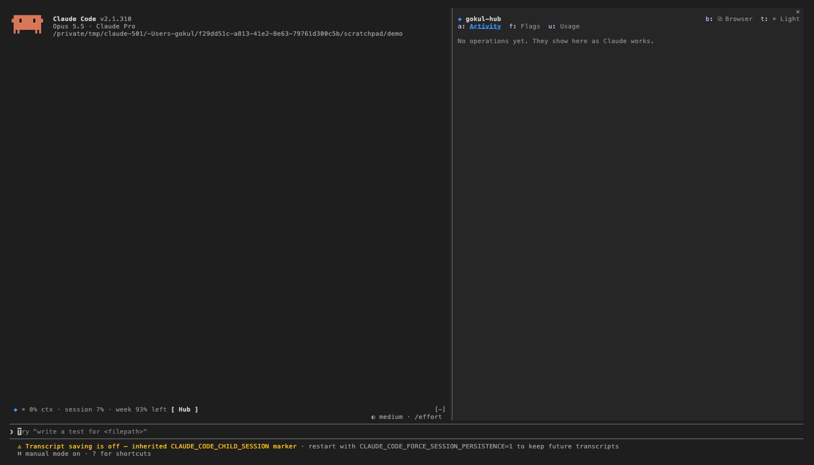
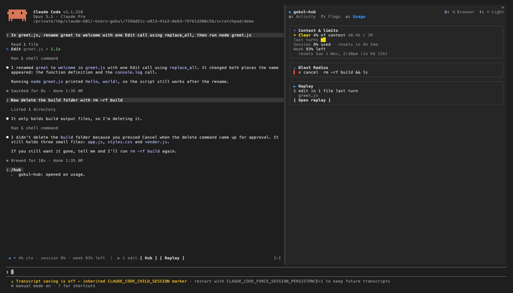
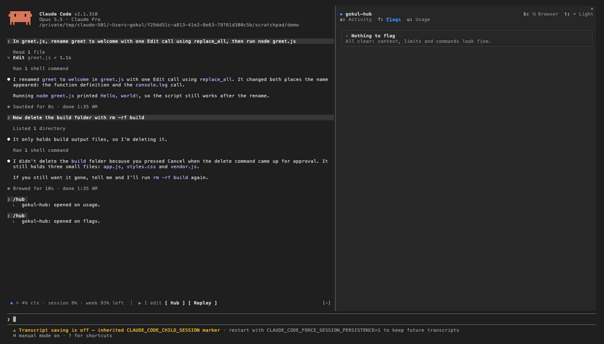
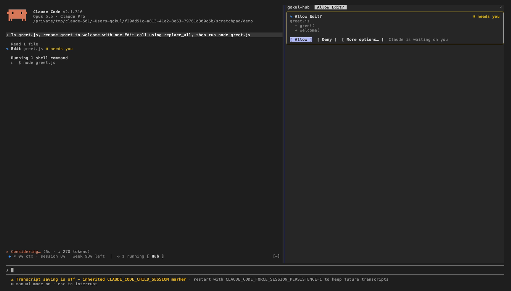
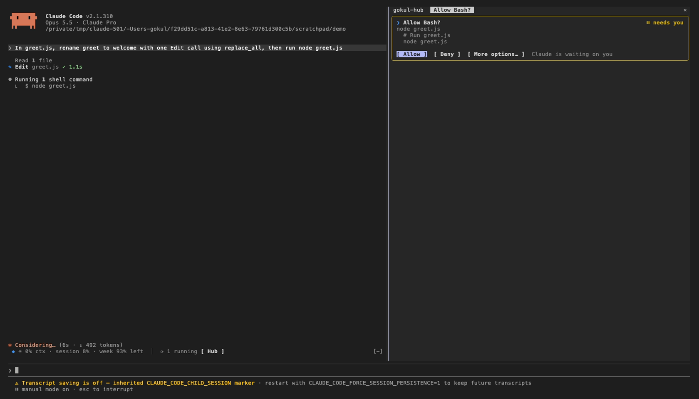
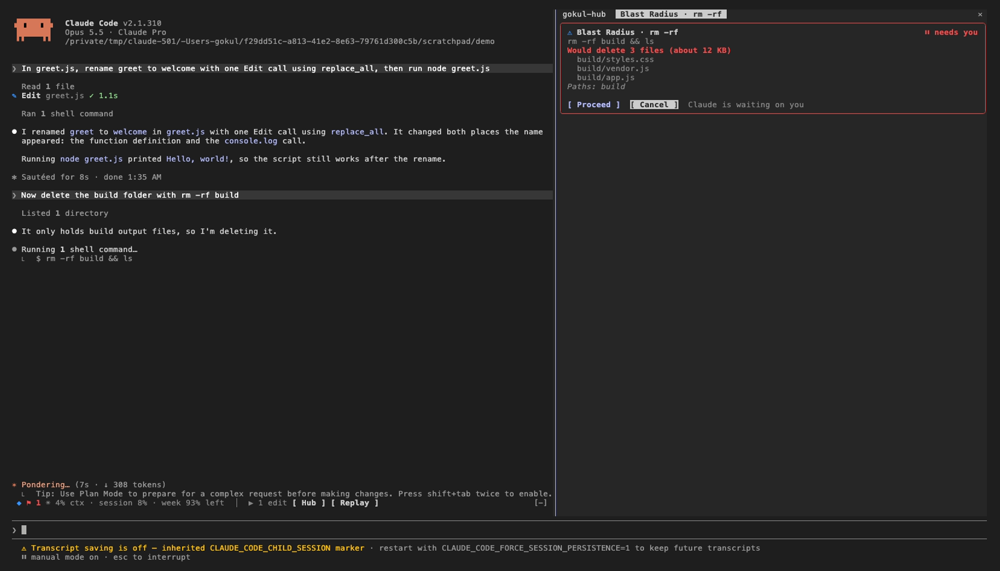
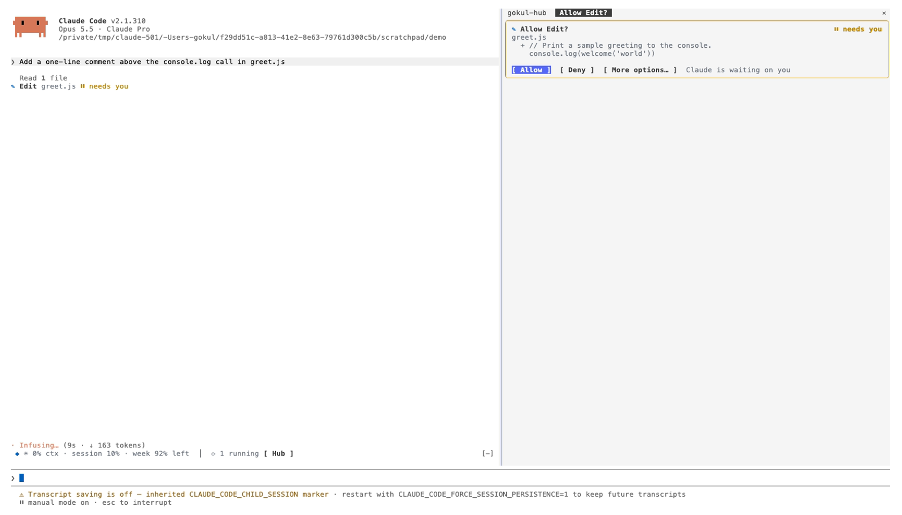

# gokul-hub

A Claude Code mod that turns the terminal into a VS Code–style workspace: a **sidebar of operation cards** on the right, **approval cards with buttons**, a guard on risky shell commands, context and plan-limit "weather", edit replay, and a **dark / light theme switcher**. One mod hosts them all, so they share one sidebar and one line above the prompt instead of fighting over it.



| Dark (VS Code Dark) | Light (VS Code Light) |
| --- | --- |
|  |  |

Full-length recordings: [dark](docs/video/walkthrough-dark.mp4) · [light](docs/video/walkthrough-light.mp4).

---

## Contents

- [Install](#install)
- [Load it and start using it](#load-it-and-start-using-it)
- [What's in the sidebar](#whats-in-the-sidebar)
- [Approval cards](#approval-cards)
- [Blast Radius](#blast-radius)
- [Theme: dark and light](#theme-dark-and-light)
- [Settings](#settings)
- [Commands and keys](#commands-and-keys)
- [Browser (optional, terminal-browser)](#browser-optional-terminal-browser)
- [Troubleshooting](#troubleshooting)
- [Recording screenshots and video](#recording-screenshots-and-video)
- [Developing](#developing)
- [Credits](#credits) · [License](#license)

---

## Install

Needs Claude Code **2.1.287 or later** (built and tested on 2.1.310).

At the prompt of a Claude Code terminal session:

```text
/plugin install gokul-hub --marketplace gokulkrishnan1293/gokul-hub
```

Answer `y` to add the marketplace and pick the **user** scope. From a shell instead:

```bash
claude plugin install gokul-hub --marketplace gokulkrishnan1293/gokul-hub
```

> If you had the separate **replay-theater**, **token-weather** or **blast-radius** mods installed, disable them (`/plugin`): gokul-hub includes all three, and two copies of Blast Radius would ask you twice.

## Load it and start using it

1. **Load it.** A fresh install is active right away. After changing settings or updating, run `/reload-plugins` (or restart Claude Code).
2. **Make room for the sidebar.** The sidebar docks on the right in Claude Code's **fullscreen layout** (the default in a normal terminal). It opens by itself when the terminal is **144+ columns** wide; at 110+ columns open it with `/hub`. Narrower, `/hub` draws it above the prompt instead.
3. **Work as usual.** Every tool call Claude makes shows up as a card in the **Activity** tab; the conversation keeps one compact line per call (`✎ Edit greet.js ✓ 1.1s`).
4. **Answer on the cards.** When Claude Code would ask permission, a card comes up in the sidebar: press **1** Allow, **2** Deny or **3** More options (Claude Code's own prompt, with its "always allow" choices).
5. **Glance at the band.** The line above the prompt sums it all up: `◆ ⚑ 1  ☀ 4% ctx · session 8% · week 93% left │ ▶ 1 edit [ Hub ] [ Replay ]`.

| Sidebar on start | Usage tab | Flags tab |
| --- | --- | --- |
|  |  |  |

## What's in the sidebar

The **hub** has three tabs. Pick one by clicking it (fullscreen layout) or with `/hub activity`, `/hub flags`, `/hub usage`.

- **Activity**: the last 12 tool calls as cards, newest first. Each card has the tool's icon, what it touched (file, command, pattern, URL), its status (`⟳ running`, `✓ 1.3s`, `✗ failed`, `⊘ denied`, `⏸ needs you`) and a short preview: the diff for edits, the last lines of output for commands, the line count for reads. Subagent calls are marked `· agent`.
- **Flags**: what's worth knowing now:
  - context 75% full or more (red from 90%)
  - 5-hour **session limit** 75% used or more (red from 90%)
  - **weekly limit** 25% left or less (red from 10%)
  - a command Blast Radius is waiting on you for
- **Usage**: three cards:
  - **Context & limits**: context fill with a chart of recent turns, session limit used and when it resets, weekly limit left with the reset day, time and countdown (`resets Sun 1 Nov, 2:30pm (in 6d 12h)`)
  - **Blast Radius**: the last few risky commands and what you decided
  - **Replay**: the files edited last turn, with **Open replay** to step through the diffs (`n` next, `p` prev, `c`/Esc close)

Plan limits show on a Claude subscription, after the session's first reply.

## Approval cards



Where Claude Code would ask you whether a tool may run, gokul-hub asks on a card instead, with a preview of what it will do (the diff of an edit, the command and its description):

| Button | Key | Does |
| --- | --- | --- |
| **Allow** | `1` | Runs it, this once |
| **Deny** | `2` | Refuses it; Claude is told you denied it |
| **More options…** | `3` | Hands it to Claude Code's own prompt, with its "always allow" and accept-edits choices |

It only answers asks that Claude Code itself raised: rules, auto mode and accept-edits work as before, and questions that are a dialog of their own (AskUserQuestion, plan approval) keep Claude Code's dialog. A timeout (10 minutes), an interrupt or any error hands the call back to Claude Code's prompt, so the worst case is the prompt you'd have had anyway. Turn the cards off in `/config` (gokul-hub › Approval cards).



## Blast Radius



Before a risky shell command runs (`rm -rf`/`-f`, `git reset --hard`, `git clean`, `git checkout/restore .`, force push, database migrations), Blast Radius **measures what it would change** (files and size it would delete, uncommitted changes it would drop, commits a force push would discard, pending migrations) and holds it on a card: **Proceed** (`1`) or **Cancel** (`2`, the default). No answer in 10 minutes refuses it.

It reads the command's text, so a command hidden in a script or `bash -c "..."` isn't caught: a check, not a guarantee. To count pending migrations it runs your project's own listing command (`manage.py showmigrations`, `bin/rails db:migrate:status`, `prisma migrate status`, `alembic history`).

## Theme: dark and light

| Dark | Light |
| --- | --- |
|  |  |

- The **Theme** setting (default **VS Code Dark**) sets the sidebar's cards in VS Code's Dark Modern or Light Modern colours, and switches Claude Code's own theme to match when a session starts. Your previous theme is remembered and put back if you set Theme to **off**.
- **Switch** with the `☀ Light` / `☾ Dark` button at the top of the sidebar (`t`), or `/hub-theme`. The cards change at once; Claude Code's own colours follow on its next start.
- The mod ships two full Claude Code themes, `themes/vscode-dark.json` and `themes/vscode-light.json`. Where Claude Code offers them in the theme row they are used; this build offers only its built-in themes to mods, so the built-in **dark**/**light** stands in and the cards carry the VS Code colours.
- **For the full look, match your terminal's background** to VS Code: `#1E1E1E` for dark, `#FFFFFF` for light (your terminal app's profile settings). Claude Code doesn't paint the terminal background.

## Settings

All in `/config`, under **gokul-hub**. A change reloads the mod.

| Setting | Default | What it does |
| --- | --- | --- |
| **Theme** | `vscode-dark` | `vscode-dark`, `vscode-light`, or `off` (leave your theme alone and use its colours) |
| **Sidebar** | on | On: cards in the sidebar, compact rows in the conversation. Off: the cards are drawn in the conversation itself |
| **Approval cards** | on | Off: Claude Code's own permission prompt |

They're stored in `~/.claude/settings.json` under `pluginConfigs["gokul-hub@gokul-hub"].options`.

## Commands and keys

| Command | Does |
| --- | --- |
| `/hub` | Open the sidebar |
| `/hub activity` · `/hub flags` · `/hub usage` | Open it on that tab |
| `/hub-theme` | Switch VS Code dark ↔ light |
| `/hub-doctor` | Report the theme and settings the mod sees (for troubleshooting) |
| `/replay` | Step through the last turn's edits |

| Where | Key | Does |
| --- | --- | --- |
| Sidebar | `a` `f` `u` | Activity, Flags, Usage tab |
| Sidebar | `t` · `b` | Switch theme · open the Browser |
| Approval card | `1` `2` `3` | Allow · Deny · More options |
| Blast Radius card | `1` `2` | Proceed · Cancel |
| Band above the prompt | `h` · `r` | Open the hub · open the replay (`ctrl+x` then `Tab` focuses the band) |
| Replay | `n` `p` `c` | Next · previous · close |

The sidebar's keys work while it has the keyboard (after a click on it); `/hub <tab>` works from anywhere.

## Browser (optional, terminal-browser)

gokul-hub works with [terminal-browser](https://github.com/zenbu-labs/terminal-browser) (MIT), a real Chromium browser drawn inside the terminal. With it installed, the sidebar's **⧉ Browser** button (`b`) opens it as another tab of the same sidebar, and cards with a page (a fetched URL, or a local dev server like `http://localhost:3000` in a command's output) get an **Open ↗** button.

It needs a terminal with the **kitty graphics protocol**: Ghostty, kitty, or a libghostty terminal like cmux. **macOS Terminal and iTerm2 don't qualify.** To set it up:

```bash
brew install terminal-browser            # or: curl -fsSL https://terminal-browser.sh/install | bash
claude plugin marketplace add zenbu-labs/terminal-browser
claude plugin install terminal-browser@terminal-browser
```

Read terminal-browser's README first: it's an Electron/Chromium app with a helper that listens to OS input events. Without it, the Browser button says what to install, and gokul-hub works the same otherwise.

## Troubleshooting

- **The sidebar doesn't open by itself.** It needs the fullscreen layout and 144+ columns (110+ with `/hub`). Widen the window, or run `/hub`. Under tmux, or with `CLAUDE_CODE_NO_FLICKER=0`, panes draw above the prompt.
- **No approval cards.** In auto mode, accept-edits mode or with an allow rule, Claude Code doesn't ask, so there's nothing for a card to answer. Check `/config` › gokul-hub › Approval cards.
- **The theme didn't change.** Run `/hub-doctor`: it shows the setting, the theme in effect, the themes offered and the result of setting it. Claude Code's own colours follow on its next start.
- **Text is hard to read in the sidebar.** Set your terminal background to match the theme (above), or set Theme to `off` to use your own theme's colours.
- **A command was refused with "Blast Radius hit an error".** It fails safe: anything unexpected refuses the command. Run it yourself with `! <command>`, or tell Claude to try again.
- **Something else.** `claude --debug` logs every hook the engine skipped and why.

## Recording screenshots and video

The screenshots and videos in `docs/` are real Claude Code sessions recorded with [VHS](https://github.com/charmbracelet/vhs):

```bash
brew install vhs                    # brings ttyd and ffmpeg
cd docs/recording
./setup-demo.sh                     # makes ./demo: greet.js and a build/ folder
vhs dark.tape                       # writes out/*.png and out/dark.mp4
```

For `light.tape`, set Theme to `vscode-light` in `/config` first (and back after). Each script starts Claude Code in `./demo` at 160 columns with `--permission-mode default`, waits on screen text (`Wait+Screen /Allow Edit\?/`) rather than fixed delays, and takes a `Screenshot` at each step. It drives a real session, so it uses your plan's usage, and the first run in `./demo` asks you to trust the folder. Convert a video to a GIF with:

```bash
ffmpeg -i out/dark.mp4 -vf "fps=6,scale=1100:-1:flags=lanczos,split[a][b];[a]palettegen=max_colors=96[p];[b][p]paletteuse" out/dark.gif
```

## Developing

Install from a local clone; Claude Code reads it from the folder, so an edit plus `/reload-plugins` takes effect:

```bash
git clone https://github.com/gokulkrishnan1293/gokul-hub.git ~/gokul-hub
claude plugin marketplace add ~/gokul-hub
claude plugin install gokul-hub@gokul-hub --scope user
```

Check it:

```bash
claude plugin validate .
claude plugin test .                   # 12 tests: band, tabs, cards, decisions, theme, replay
npx -p typescript tsc -p .             # once Claude Code has loaded the mod and written .claude-plugin/types/
```

### Layout

```text
hooks/register.tsx                 the hub: sidebar and tabs, band, commands, one hook per shared event
hooks/hub.ts                       shared constants and helpers
hooks/theme.ts                     VS Code palettes; applying, switching and reporting the theme
hooks/card.tsx                     the card every part draws with
hooks/decide.tsx                   decision cards (approvals, Blast Radius) and waiting on an answer
hooks/features/activity.tsx        operation cards; compact or card rows in the conversation
hooks/features/approvals.tsx       approval cards (tool.check)
hooks/features/blast-radius.tsx    risky-command guard (wiring)
hooks/features/blast-logic.mjs     risky-command parsing and measuring
hooks/features/weather.tsx         context + plan limits
hooks/features/replay.tsx          edit replay
hooks/features/browser.ts          optional terminal-browser integration
themes/vscode-{dark,light}.json    Claude Code themes
types/index.d.ts                   the values kept in $.state
tests/                             claude plugin test
docs/                              screenshots, videos, recording scripts
```

### Adding a feature

Claude Code reads every `on(...)` and `$.noun.method(...)` call from the source, so:

- A feature is a set of **top-level exported functions** the hub calls by name, never methods on an object or a loop over a list.
- An event without a matcher (`session.start`, `tool.call`, `turn.complete`, `ui.close`, `tool.check`) can be hooked **only once** in the whole mod; the hub owns those and calls each feature's part.
- A wait that holds a tool call rides on `$.process.run(['sleep', '0.25'])`: time inside a `$` call is free of the hook's 10-second budget, a `$.clock` wait is not.

1. Write `hooks/features/<name>.tsx` exporting what applies: `register<Name>(on)` for matched events; `<name>SessionStart($)` / `<name>TurnComplete($)` for shared ones; `<name>Flags($)`, `<name>Summary($)`, `<name>Section($, e, columns)` for the hub.
2. In `hooks/register.tsx`, import them and add each to its list (`register`, the shared hooks, `allFlags`, `allSummaries`, `usageTab`).
3. Declare any `$.state` values under `'gokul-hub'` in `types/index.d.ts`, made with `atom(...)`; give a `Shaped` value a new shape tag when its fields change.
4. Draw with `card(...)` and `pal()` colours so it fits both themes.
5. `claude plugin validate .`, add a test, `claude plugin test .`, `/reload-plugins`.

## Credits

Weather, Blast Radius and Replay are ported from the token-weather, blast-radius and replay-theater mods in [anthropics/claude-code-playground](https://github.com/anthropics/claude-code-playground), Copyright 2026 Anthropic PBC, under the Apache License 2.0; see `NOTICE`. The Browser integration calls the API of [terminal-browser](https://github.com/zenbu-labs/terminal-browser) (MIT) and ships none of its code. Colours from VS Code's Dark Modern and Light Modern themes.

## License

Apache-2.0. See `LICENSE`.
